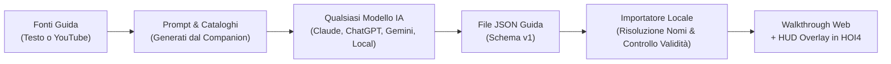

<div align="center">

# 🎖️ HOI4 Companion

### L'assistente esterno per Hearts of Iron IV: alberi interattivi, guide strategiche con supporto AI, monitoraggio live in memoria e HUD overlay in-game.

[](https://github.com/altairflyy/hoi4companion/releases)
[](https://github.com/altairflyy/hoi4companion/releases)
[](https://github.com/altairflyy/hoi4companion/actions)
[](https://github.com/altairflyy/hoi4companion/releases/latest)
[-critical?logo=paradoxinteractive&logoColor=white&style=flat-square)](#-compatibilit%C3%A0-e-requisiti)
[](https://www.python.org/)
[](#-architettura-e-tecnologie)
[](LICENSE)

<br/>

<p align="center">
  <a href="https://github.com/altairflyy/hoi4companion/releases/latest">
    
  </a>
  &nbsp;&nbsp;
  <a href="https://github.com/altairflyy/hoi4companion/releases">
    
  </a>
  &nbsp;&nbsp;
  <a href="docs/windows-distribution.md">
    
  </a>
</p>

*100% Gratuito & Open Source • Zero installatori invasivi • Runtime completo integrato*

---

</div>

> [!IMPORTANT]
> **HOI4 Companion è uno strumento complementare di consultazione e ausilio visivo, non un bot o un cheat.**
> - Legge i file installati di gioco e mod e, sulle build supportate, effettua **esclusivamente letture passive della memoria**.
> - **Non gioca al tuo posto**, non preme pulsanti, non altera il codice di gioco e non scrive nella memoria del processo.
> - Non è un prodotto Paradox Interactive e non include gli asset proprietari del gioco.

---

## ⚡ Caratteristiche Principali

```
  ┌────────────────────────────────────────────────────────────────────────┐
  │                           HOI4 COMPANION                               │
  ├───────────────────┬───────────────────┬────────────────────────────────┤
  │   HUD OVERLAY     │   ESPLORATORE     │   GUIDE & AI                   │
  │   Direct2D + Rust │   Focus & Tech    │   Importatore Universale       │
  │   Evidenziazioni  │   Parser Jomini   │   Supporto Video & Cataloghi   │
  ├───────────────────┼───────────────────┼────────────────────────────────┤
  │   TELEMETRIA LIVE │   GEO RESOLUTION  │   100% PORTABILE               │
  │   Memoria a 0ms   │   Città & Regioni │   Zero dipendenze esterne      │
  │   Server SSE      │   Indice Locale   │   Batterie incluse             │
  └───────────────────┴───────────────────┴────────────────────────────────┘
```

- 🎯 **HUD Overlay Trasparente In-Game (Direct2D + Rust)**: Disegna riquadri di puntamento direttamente sopra Hearts of Iron IV a zero impatto sulle prestazioni grafiche per evidenziare il prossimo focus, le ricerche raccomandate e le decisioni chiave.
- 🌲 **Esploratore Nativi Alberi Focus & Tecnologie**: Navigazione visuale completa ricavata direttamente dai file locali e dalle mod attive grazie al parser Jomini nativo compilato in Rust.
- 🤖 **Importatore Guide Universale AI-Assisted**: Supporta qualsiasi intelligenza artificiale esterna (Claude, ChatGPT, Gemini, LLM locali). Fornisci il prompt integrato e carica il file JSON della guida generata: **nessuna chiave API o connessione a pagamento richiesta**.
- ⚡ **Monitoraggio Live in Memoria a Zero Latenza**: Streaming in tempo reale (SSE) dello stato di gioco (divisioni, manpower, fabbriche, cantieri, materiali e ricerche attive) senza dover salvare la partita o attendere il salvataggio automatico.
- 🗺️ **Risoluzione Geografica & Indici Intelligenti**: Collega automaticamente nomi di città, punti vittoria e province alle relative regioni e infrastrutture statali o provinciali dai dati del gioco.
- 📦 **100% Autonomo e Portabile**: La distribuzione Windows include Python 3.13, Node.js, FFmpeg, OpenCV, yt-dlp e il runtime CWTools .NET: **funziona subito senza dover installare alcunché sul PC**.

---

## 🚀 Download & Installazione Rapida (Windows x64)

Non serve un programma di installazione né privilegi di amministratore di sistema.

1. **Scarica il pacchetto**:
   Accedi alla sezione **[Releases](https://github.com/altairflyy/hoi4companion/releases/latest)** e scarica l'archivio:
   ```text
   HOI4Companion-0.1.1-windows-x64.zip
   ```
   *(I file denominati "Source code" contengono solo il codice sorgente, non il runtime completo).*
2. **Estrai l'archivio**:
   Fai clic destro sul file ZIP ed estrai **tutto il contenuto** in una cartella a tua scelta (es. `C:\Giochi\HOI4Companion`).
3. **Avvia l'applicazione**:
   Fai doppio clic su **`HOI4 Companion.exe`**.
   - Si aprirà automaticamente il browser su [http://127.0.0.1:8766/walkthrough](http://127.0.0.1:8766/walkthrough) insieme al pannello di controllo dell'HUD.
   - Il primo caricamento e indicizzazione dei file di gioco potrebbe richiedere qualche istante.
4. **Configura i percorsi**:
   Nella scheda **Configurazione**, verifica o specifica la cartella del gioco (dove risiede `hoi4.exe`) e la cartella Documenti di HOI4.

> [!TIP]
> **Modalità solo interfaccia Web**:
> Se non desideri l'HUD sopra la finestra di gioco, puoi avviare il Companion con il flag:
> ```powershell
> & '.\HOI4 Companion.exe' --no-hud
> ```

---

## 🖥️ Le Schermate dell'Applicazione

| Schermata | Icona | Descrizione & Funzionalità |
| :--- | :---: | :--- |
| **Focus Nazionali** | 🌲 | Albero completo renderizzato fedelmente dai file del gioco/mod, icone ufficiali, descrizioni localizzate e target attuale della guida. |
| **Tecnologie & Ricerca** | 🔬 | Mappe tecnologiche con layout di gioco, cartelle specializzate, slot liberi/occupati e rami raccomandati. |
| **Walkthrough Operativo** | 📋 | Istruzioni per costruzioni (fabbriche, forti), produzioni, decisioni politiche, nomine ed eventi con fotogrammi di supporto. |
| **Stato Nazione Live** | 📊 | Telemetria in tempo reale: divisioni sul campo, riserve di manpower, cantieri navali, bilancio materiali e risorse industriali. |
| **Importa Guida** | 📥 | Generatore di prompt per LLM, cataloghi tematici esportati, preparatore video YouTube e risolutore contestuale di associazioni. |
| **Analisi Script** | 🔍 | Diagnostica avanzata degli script di gioco e delle mod tramite integrazione nativa con CWTools (.NET 9). |

Il Walkthrough comprende un [riepilogo operativo contestuale](docs/operational-summary.md): confronta obiettivi e dati disponibili, distinguendo fabbriche richieste/assegnate, attività in corso e condizioni non verificabili, senza modificare i completamenti del runtime.

Il Focus Explorer ricava spaziatura, composizione e ancoraggi dai file GUI installati, con [texture originali dei collegamenti e gestione esplicita dei limiti](docs/focus-fidelity.md).

---

## 🧭 Workflow Guide & Intelligenza Artificiale



1. **Esporta il Contesto**: Apri **Importa guida**, seleziona la nazione d'interesse e scarica il prompt dedicato corredato dai cataloghi tematici.
2. **Genera con l'IA**: Invia il prompt e le fonti alla tua IA preferita. L'IA genererà un file JSON strutturato.
3. **Importa e Valida**: Carica il JSON nell'importatore. L'indice locale risolverà le ambiguità geografiche e di localizzazione.
4. **Gioca**: Seleziona la guida nel **Walkthrough** e mantieni l'HUD attivo sopra HOI4 per seguire gli obiettivi passo dopo passo.

---

## 🔍 Compatibilità e Requisiti

| Componente | Requisito / Dettaglio |
| :--- | :--- |
| **Sistema Operativo** | Windows 10 / 11 a 64 bit (x64) |
| **Hearts of Iron IV** | Installazione ufficiale di HOI4 (non inclusa) |
| **Lettura Live della Memoria** | Build Windows supportata: `Operation Postern v1.19.3.0.c01a (42c3)` *(SHA-256: `7dc947be34970da1e1c787bcddbe7f62b610ff258aebf8f06aa8b348f3a031d5`)* |
| **Browser Web** | Qualsiasi browser moderno (Edge, Chrome, Firefox, Brave) |
| **Privilegi Richiesti** | Standard utente (nessun accesso come amministratore richiesto) |

> [!NOTE]
> L'esplorazione dei file locali, il parser degli alberi e l'importazione guide **sono indipendenti dalla specifica build di memoria** e funzionano con qualsiasi versione supportata e con la maggior parte delle mod.

---

## 🛠️ Architettura e Tecnologie

HOI4 Companion adotta un'architettura ibrida ad alte prestazioni:

- **Core & API**: Python 3.13 con server asincrono, zero-dependency storage in `%LOCALAPPDATA%\HOI4Companion`.
- **Parser Jomini Nativo**: Rust con binding nativi ad altissima velocità per la lettura di file Clausewitz (`.gui`, `.txt`, `.gfx`).
- **HUD & Compositor**: Rust + Windows Direct2D / GDI per un rendering trasparente e fluido privo di hook invasivi.
- **Analisi Script**: Host .NET 9 integrato per eseguire le regole CWTools senza runtime installato a livello di sistema.
- **Multimedialità**: Node.js, FFmpeg nativo e yt-dlp inclusi per il preprocessing di guide video e trascrizioni.

---

## 💻 Sviluppo dal Sorgente

Se desideri contribuire o compilare il progetto dal codice sorgente:

### Prerequisiti
- Python 3.11+
- Rust con toolchain MSVC (`stable-x86_64-pc-windows-msvc`)
- .NET SDK 9 (configurato in `native/cwtools/global.json`)
- Node.js 20+

### Setup dell'ambiente
```powershell
# Clona il repository
git clone https://github.com/altairflyy/hoi4companion.git
cd hoi4companion

# Installa in modalità modificabile con supporto overlay
py -3 -m pip install -e '.[overlay]'

# Esegui i test di regressione
$env:PYTHONPATH = "$PWD\src"
py -3 -m unittest discover -s tests -p 'test_*.py'
node --test tests/*.cjs
```

### Compilazione della Distribuzione Standalone
```powershell
py -3.13 -m venv .venv-build
& .venv-build\Scripts\python.exe -m pip install -r packaging\requirements-windows.lock
& .venv-build\Scripts\python.exe scripts\build-windows.py
& .venv-build\Scripts\python.exe scripts\smoke-windows.py dist\HOI4Companion
```

---

## 📚 Documentazione Dettagliata

- 📖 [Distribuzione Windows Standalone](docs/windows-distribution.md)
- 📝 [Formato e Scrittura Guide per l'IA](docs/guide-authoring.md)
- 📥 [Architettura dell'Importatore](docs/guide-importer.md)
- ⚙️ [Runtime di Valutazione Guide](docs/guide-runtime.md)
- 🎮 [Overlay Nativo e Linee Guida HUD](docs/native-overlay.md)
- 💾 [Persistenza delle Campagne e Identità Run](docs/campaign-progress.md)
- 🦀 [Parser Jomini Rust e Migrazione](docs/jomini-migration.md)
- 🎬 [Elaborazione e Segmentazione Video](docs/guide-video-workflow.md)

---

## ⚖️ Licenza & Note Legali

- Il codice sorgente di **HOI4 Companion** è rilasciato sotto licenza [MIT](LICENSE).
- I componenti e le librerie di terze parti mantengono le rispettive licenze originali, incluse nella cartella `THIRD-PARTY` e nella documentazione della distribuzione.
- **Hearts of Iron IV** e tutti i marchi, loghi, testi e asset correlati sono proprietà esclusiva di **Paradox Interactive AB**. Questo progetto non è affiliato né approvato da Paradox Interactive.
